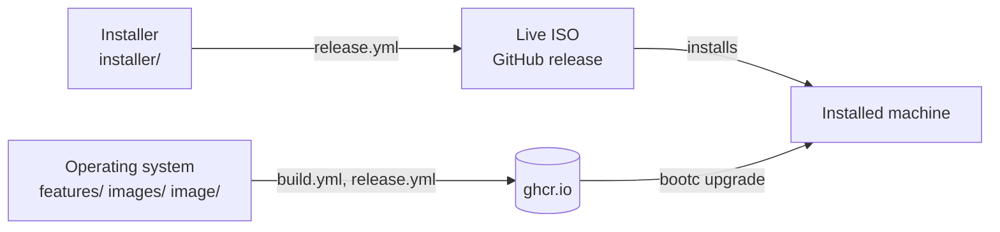

# Fedora bootc

A Fedora 44 desktop built as a bootable container image, fedora-bootc is
installed and updated with [bootc](https://bootc.dev/) and accepts only
cosign-signed updates. It uses bootc's
[composefs backend](https://bootc.dev/bootc/experimental-composefs.html) and
boots systemd-boot and a sealed unified kernel image (UKI), both signed with
custom Secure Boot keys.

The repository has two parts:



## Operating system

The OS includes this software:

- greetd with noctalia-greeter
- Five Wayland sessions running the [Noctalia](https://noctalia.dev) shell:
  niri, labwc, sway, river, and wayfire
- ghostty and fish
- podman and docker
- QEMU/KVM with Virtual Machine Manager
- XRDP
- A local LLM server, off by default

For details, see [OS overview](docs/os.md).

The image `ghcr.io/lucarickli/fedora-bootc` has these tags:

| Tag                          | Image                                |
| ---------------------------- | ------------------------------------ |
| `latest-uki`                 | Sealed and signed                    |
| `nvidia-uki`                 | The same, with the NVIDIA driver     |
| `latest`, `nvidia`           | Unsealed                             |
| `live`                       | The live ISO's system                |
| `build-SHA`, `build-SHA-uki` | Built from commit `SHA`, for testing |

Releases ship every Monday, and within a day when the published images lack a
critical Fedora security update. For details, see
[How fixes are released](SECURITY.md#how-fixes-are-released).

A machine never updates by itself. Update or roll back with `bootc`:

```sh
sudo bootc upgrade          # Stage the newest image for the next boot
sudo bootc upgrade --apply  # Stage it and reboot into it
sudo bootc rollback         # Boot the previous image next time; the boot menu also lists it
sudo bootc status           # Show the booted, staged, and rollback images
sudo bootc switch ghcr.io/lucarickli/fedora-bootc:latest-uki  # Once, after installing a local build
```

## Installer

The live ISO's graphical wizard installs `latest-uki`, or `nvidia-uki` on
machines with NVIDIA GTX 16 / RTX 20 series GPUs and newer. Download the ISO
from a [release](https://github.com/lucarickli/fedora-bootc/releases) or build
it with `just iso`, and boot it with Secure Boot off. To install with the
wizard, or manually from any live USB drive, follow
[Install fedora-bootc](docs/install.md).

After installing,
[enroll the Secure Boot keys](docs/secureboot-tpm2.md#enroll-the-keys), then
[bind LUKS to the TPM](docs/secureboot-tpm2.md#bind-luks-to-the-tpm).

## Build the images

The [`Justfile`](Justfile) recipes need rootless `podman` and `just` 1.48 or
newer, and the VM recipes need [`bcvk`](https://github.com/bootc-dev/bcvk). The
development tools, a VS Code Flatpak and a dev container, include `just` and
`bcvk`. For a shell with them, run:

```sh
toolbox create --image ghcr.io/lucarickli/devcontainer:latest dev
toolbox enter dev
```

The VM recipes (`qcow2`, `demo-user`, `vm`, `vm-secureboot`, and `vm-enroll`)
run podman and QEMU on the host, even from a toolbox or the VS Code Flatpak
terminal with host access. The host needs `/dev/kvm`, `qemu`, `qemu-img`,
`virtiofsd`, `edk2-ovmf`, `openssh-clients`, systemd, glibc 2.39 or newer, and
`binutils`, because `bcvk` runs `objcopy` on a sealed image's UKI. A
fedora-bootc machine has all of them.

The private [signing keys](keys/README.md) are in
`~/.local/share/fedora-bootc/keys`, which the Flatpak can't see. Run the
recipes that use or create them, such as `build`, `seal`, and `keygen`, from a
host shell or a toolbox.

These recipes build and test the images:

```sh
just build                # Build the OS: localhost/fedora-bootc:latest (unsealed), :latest-uki (sealed)
just build nvidia         # Build the NVIDIA image: :nvidia, :nvidia-uki
just build nvidia closed  # The same with the closed kernel modules, for GTX 900 and 1000 series GPUs
just qcow2                # Install :latest-uki into output/disk.qcow2
just demo-user            # Optional: add a demo/demo login to that disk only
just vm                   # Boot the disk; the greeter listing five sessions is the pass
just vm-secureboot        # The same with Secure Boot enforcing; untested with Fedora's OVMF
just vm-enroll            # Enroll the image's Secure Boot keys from systemd-boot, then boot under them
just check                # Check script syntax and how the features fit together
just iso                  # Build the live ISO: output/fedora-bootc-live.iso
just --list               # List every recipe
```

> [!WARNING]
> The composefs backend is experimental. Boot-test every build in a VM before
> you install it on hardware.

## Documentation

- [Install fedora-bootc](docs/install.md)
- [Set up Secure Boot and TPM2 auto-unlock](docs/secureboot-tpm2.md)
- [OS overview](docs/os.md)
- [Recover a system](docs/rescue.md)
- [Pull images through a cache](docs/pull-through-cache.md)
- [Create your own fork](docs/fork.md)
- [How the build works](docs/architecture/build.md)
- [Updates, scanning, and CI](docs/architecture/updates.md)
- [Security policy](SECURITY.md)
- [Features](features/README.md)
- [Images](images/README.md)
- [Signing keys](keys/README.md)
