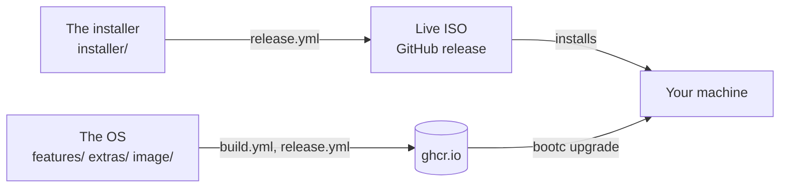

# Fedora bootc

A personal Fedora 44 desktop, built as a bootable container image and
installed and updated by [bootc](https://bootc.dev/). It boots systemd-boot and
a sealed UKI ([composefs backend](https://bootc.dev/bootc/experimental-composefs.html))
signed with your own Secure Boot key, and only accepts cosign-signed updates.

Two parts, each built and shipped on its own:



## The OS

`features/` (one folder per feature: its packages, files and setup),
`extras/` (images with more on top, such as the NVIDIA driver), `image/`
(the build steps)

greetd with noctalia-greeter, five Wayland sessions (niri, labwc, sway, river,
wayfire) running the [Noctalia](https://noctalia.dev) shell, ghostty and fish,
podman and docker, QEMU with Virtual Machine Manager, XRDP, a local LLM server
(shimmy, off by default). More, with remote desktop, VMs, the LLM and NVIDIA:
[docs/os.md](docs/os.md).

```sh
sudo bootc upgrade     # stage the newest image for the next boot (--apply: reboot into it)
sudo bootc rollback    # back to the previous one (also in the boot menu)
sudo bootc status
sudo bootc switch ghcr.io/lucarickli/fedora-bootc:latest-uki  # once, after installing a local build
```

| Tag                                   | Image                                                                                |
| ------------------------------------- | ------------------------------------------------------------------------------------ |
| `latest-uki`                          | sealed and signed; what the ISO installs (`nvidia-uki` on GTX 16 / RTX 20 and newer) |
| `nvidia-uki`                          | the same, with the NVIDIA driver                                                     |
| `latest`, `nvidia`                    | unsealed (kernel in place)                                                           |
| `build-<sha>`, `build-<sha>-uki`, ... | one per build, for testing it                                                        |

A release every Monday, and one within a day when the released images lack
a critical Fedora security update; a machine takes it when you run
`sudo bootc upgrade`, never by itself. Releases, updates, scanning and CI:
[docs/architecture/updates.md](docs/architecture/updates.md); reporting a
vulnerability: [SECURITY.md](SECURITY.md).
Also: Secure Boot and TPM2
([docs/secureboot-tpm2.md](docs/secureboot-tpm2.md)), rescue
([docs/rescue.md](docs/rescue.md)), pulling through a cache
([docs/pull-through-cache.md](docs/pull-through-cache.md)), enterprise Wi-Fi
([docs/enterprise-wifi.md](docs/enterprise-wifi.md)).

## The installer

`installer/`

A live ISO with a graphical wizard, which installs `latest-uki` (`nvidia-uki`
on a GTX 16 / RTX 20 series or newer). Take it from a
[release](https://github.com/lucarickli/fedora-bootc/releases) or build it with
`just iso`, boot it and follow the wizard. Without the ISO, `bootc install`
from any live USB: [docs/install.md](docs/install.md). Afterwards, enroll your
Secure Boot keys and bind LUKS to the TPM:
[docs/secureboot-tpm2.md](docs/secureboot-tpm2.md).

## Building it

`image/*.Containerfile`, `installer/live.Containerfile`, `Justfile`,
`scripts/` (helpers the recipes run). Needs rootless `podman` and `just`
(1.48 or newer), the VM recipes also `bcvk`, `qemu` and OVMF. The
development tools (the VS Code Flatpak and the dev container, a repository
of their own) bring `just` and `bcvk`; `toolbox create --image
ghcr.io/lucarickli/devcontainer:latest dev` gives a shell with them.

The VM recipes (`qcow2`, `demo-user`, `vm`, `vm-secureboot`) also run from the
VS Code terminal (with host access) and from a toolbox: bcvk drives the
host's podman and qemu runs there, so the host needs rootless podman,
`/dev/kvm`, qemu, qemu-img, virtiofsd, edk2-ovmf (the recipes pick Arch's or
Fedora's files), binutils (objcopy, for the sealed UKI image),
openssh-clients, systemd and glibc 2.39 or newer. A fedora-bootc machine has
them (`features/virtualization`). The recipes that use or make the signing
keys (`build`, `seal`, `keygen`) run from a host shell or a toolbox: the
Flatpak cannot see the key directory. On Arch:

```sh
sudo pacman -S --needed podman qemu-base qemu-ui-gtk qemu-ui-opengl virtiofsd edk2-ovmf binutils openssh
```

```sh
just build           # the OS: localhost/fedora-bootc:latest (unsealed), :latest-uki (sealed)
just build nvidia    # the NVIDIA extra: :nvidia, :nvidia-uki (`just build nvidia closed` for GTX 900/1000)
just qcow2           # install :latest-uki into output/disk.qcow2
just demo-user       # optional: demo/demo login, on that disk only
just vm              # boot it; the greeter listing five sessions is the pass
just vm-secureboot   # the same with Secure Boot enforcing
just check           # script syntax, and how the features fit together
just iso             # live installer: output/fedora-bootc-live.iso
```

The composefs backend is experimental: boot-test every build in a VM before it
goes near real hardware. How the build works, stage by stage:
[docs/architecture/build.md](docs/architecture/build.md). `just --list` shows
the rest. Your own copy, with your keys and CI: [docs/fork.md](docs/fork.md).
`keys/` holds the Secure Boot certificates and the cosign public key; the
private keys a build signs with live outside the checkout, in
`~/.local/share/fedora-bootc/keys` ([keys/README.md](keys/README.md)).
