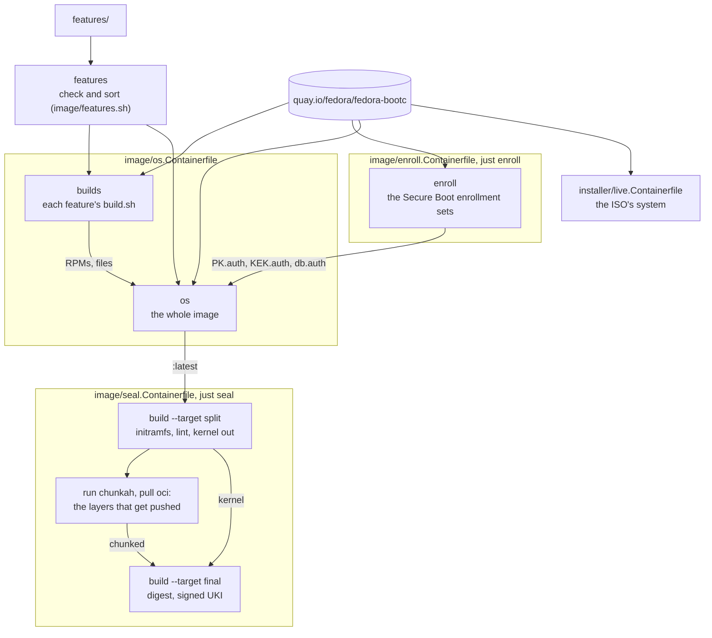
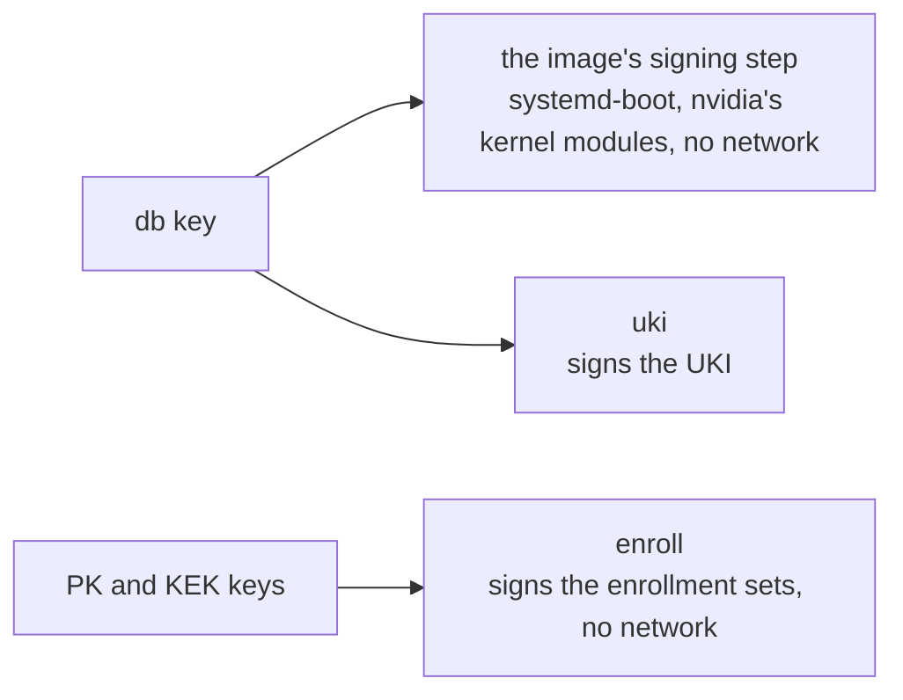
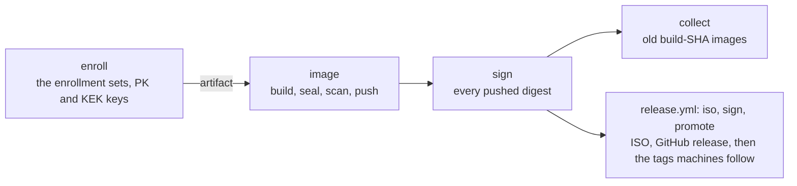

# How the build works

The [`Justfile`](../../Justfile) recipes build four Containerfiles the same way
locally and in CI. The image has every [feature](../../features/). The local
tags of `localhost/fedora-bootc` match the registry's:

| File                                                                 | Builds                                                     | Local tag                                     |
| -------------------------------------------------------------------- | ---------------------------------------------------------- | --------------------------------------------- |
| [`image/enroll.Containerfile`](../../image/enroll.Containerfile)     | The Secure Boot enrollment sets                            | None: `just enroll DIR` exports them to `DIR` |
| [`image/os.Containerfile`](../../image/os.Containerfile)             | The image, unsealed                                        | `latest`                                      |
| [`image/seal.Containerfile`](../../image/seal.Containerfile)         | The image, sealed into a signed unified kernel image (UKI) | `latest-uki`                                  |
| [`installer/live.Containerfile`](../../installer/live.Containerfile) | The live ISO's system                                      | `live`                                        |

`just build` runs `build-image`, then `seal`. `build-image` runs `enroll`
first, unless `ENROLL_DIR` names sets that are already signed.

## Build stages

These stages build the image:

**`features`** ([`image/features.sh`](../../image/features.sh)) checks the
features and sorts them. Each later step gets only its own part, which keeps
the cache useful.

**`builds`** ([`image/builds.sh`](../../image/builds.sh)) runs each feature's
`build.sh` to build what Fedora doesn't package, from pinned upstream versions:
noctalia-greeter as an RPM and shimmy as a binary. It starts from the image's
base with Fedora's updates, so the results link against the image's libraries.

**`enroll`** ([`image/enroll.sh`](../../image/enroll.sh)) signs the Secure Boot
enrollment sets, one with Microsoft's certificates from `keys/microsoft/` and
one without. Each holds the signed EFI variables for the Platform Key (PK), Key
Exchange Key (KEK), and signature database (db), which
[`image/sbauth.sh`](../../image/sbauth.sh) checks as the firmware does. They're
signed in a build of their own and passed to the image build as the build
context `enroll`. A machine enrolls a set from the
systemd-boot menu ([Enroll the keys](../secureboot-tpm2.md#enroll-the-keys)).

**`os`** is an ordinary bootc image with its kernel in place, built in five
steps:

1. [`image/groups.sh`](../../image/groups.sh): every stable Fedora update
   (`dnf upgrade`), the comps groups that the features name in `groups.txt`,
   and a record of the security advisories that dnf knew, for the scan.
2. [`image/packages.sh`](../../image/packages.sh): each feature's
   `pre-install.sh`, then every feature's packages and the built RPMs in one
   dnf transaction, then each `post-install.sh`, such as the boot feature's,
   which removes GRUB, bootupd, and rpm-ostree.
3. [`image/sign.sh`](../../image/sign.sh), with the db key and no network:
   each feature's `sign.sh`, such as the boot feature's, which signs
   systemd-boot, and the nvidia feature's, which builds and signs kernel
   modules for the image's kernel.
4. The features' `overlay/` trees, the built files, the cosign public key, and
   the enrollment sets in `/usr/lib/bootc/install/secureboot-keys/`, where
   `bootc install` finds them.
5. [`image/finalize.sh`](../../image/finalize.sh): the features' systemd
   presets, each `setup.sh`, and checks of the image as a whole.

[`installer/live.Containerfile`](../../installer/live.Containerfile) starts
from the plain Fedora base with Fedora's updates, not from the OS, because the
[installer](../../installer/) pulls the OS image from the registry.

## Sealing

`just seal [SRC]` seals `SRC`, by default `localhost/fedora-bootc:latest`, into
`latest-uki` in three commands:

1. `podman build --target split`:
   [`image/initramfs.sh`](../../image/initramfs.sh) rebuilds the initramfs,
   `bootc container lint` runs, and the kernel and initramfs move out of the
   rootfs. The result is `latest-split`.
2. `podman run`: the pinned chunkah rechunks the rootfs into layers, with the
   split image read-only, no network, and an empty directory under
   `${TMPDIR:-/var/tmp}` that needs about 10 GB. Then `podman pull oci:`
   imports them.
3. `podman build --target final`: the `uki` stage seals the composefs digest of
   the imported layers and the `kargs.d` kernel arguments into a UKI signed
   with the db key ([`image/uki.sh`](../../image/uki.sh)). Then
   [`image/uki-trust.sh`](../../image/uki-trust.sh) checks that every
   enrollment set trusts the UKI and systemd-boot. The `final` stage is the
   import plus that UKI in `/boot/EFI/Linux/`.

> [!IMPORTANT]
> The digest must come from the import, because `bootc install` pulls those
> layers. With a digest computed from a build stage, the UKI refuses to install
> or boot ("wrong composefs= parameter").

## Caching

CI jobs have no cache. Locally, each step is a cached layer, and a change
reruns its step, every later one, and the seal:

| Change                                                                         | Reruns                                                                                               |
| ------------------------------------------------------------------------------ | ---------------------------------------------------------------------------------------------------- |
| Nothing                                                                        | Only chunkah and the import, in seconds                                                              |
| A feature's `setup.sh` or `overlay/`, except `etc/yum.repos.d/`                | `finalize.sh` (seconds)                                                                              |
| A feature's package list, `.repo` file, `pre-install.sh`, or `post-install.sh` | The package step (minutes)                                                                           |
| A feature's `groups.txt` or `exclude.txt`                                      | The group step (minutes)                                                                             |
| A feature's `build.sh` or the files next to it                                 | Every build, then the package step if a built RPM changed, or `finalize.sh` if only a built file did |
| A feature's `sign.sh`                                                          | The image from its signing step, and the seal                                                        |
| The db certificate                                                             | The signing steps and the enrollment sets                                                            |
| The PK or KEK certificate, or `keys/GUID`                                      | The enrollment sets, then `finalize.sh`                                                              |
| `image/enroll.sh`, `image/sbauth.sh`, or `keys/microsoft/`                     | The enrollment sets (seconds), then `finalize.sh` if their bytes change                              |
| `image/initramfs.sh`                                                           | The seal from its split step                                                                         |
| `image/uki.sh`                                                                 | The seal's `uki` stage                                                                               |
| `image/uki-trust.sh` or `image/sbauth.sh`                                      | The seal's trust step                                                                                |
| The Fedora base image, refreshed daily                                         | Everything; between refreshes, a local build keeps its cached Fedora updates                         |
| Docs or CI files                                                               | Nothing: `.containerignore` keeps them out                                                           |

## Signing keys

The private keys live outside the checkout
([Key locations](../../keys/README.md#key-locations)). A build gets the Secure
Boot keys and certificates as podman secrets, which never enter a layer. It
mounts each key only into the steps that sign with it:

The db certificate also goes to `enroll`, for `db.auth`. `just check` fails on
any of these:

- A Secure Boot secret mounted into any other step.
- A signing step or the `enroll` step with a network, or with more mounted
  than its own context.
- A step that mounts the build context, because such a mount ignores
  `.containerignore` and can read all of `keys/`.
- A parser directive or a variable in a mount option, because `just check`
  reads the Containerfiles as plain text.

The cosign key never reaches a build. CI signs after the push, in its own job
([Signing](updates.md#signing)).

## Build checks

These checks fail a build:

- `image/features.sh`: a file shipped twice, a hook that can't run, a file
  that isn't a feature file, or a list entry that isn't one package or group
  name.
- `image/builds.sh`: a `build.sh` that fails, or two builds that make the same
  file or RPM.
- Each `setup.sh`: its checks, including what its feature needs from another.
- `image/finalize.sh`: a built file that's also in an overlay, a unit that
  isn't in the state its preset names, an RPM that an `exclude.txt` names, or a
  private key left in the image.
- `image/enroll.sh`: a PK or KEK key that doesn't match its certificate, or an
  enrollment set that `image/sbauth.sh` rejects.
- `just enroll`, and `build-image` for the sets in `ENROLL_DIR`: a folder that
  holds more than the enrollment sets' `.auth` files, or sets that don't
  enroll the certificates in `keys/`.
- `image/initramfs.sh`: a dracut module, kernel module, or file that the dracut
  configuration declares and the initramfs lacks, such as the boot splash or
  the nvidia modules for early kernel mode setting.
- `image/uki-trust.sh`: an enrollment set whose db doesn't trust the UKI or
  systemd-boot, so a machine that enrolled it couldn't boot.
- `bootc container lint`: a lint error.
- `just verify-chunkah`, in CI before the `image` job's build: a chunkah pin
  that its release workflow didn't sign.
- The scan, in CI before every push ([Scanning](updates.md#scanning)).

## Local and CI builds

Each push in [`build.yml`](../../.github/workflows/build.yml) goes through
[`.github/actions/publish`](../../.github/actions/publish/action.yml) to one
immutable tag, where `SHA` is the commit's seven-character short hash:

| Build           | Local                                     | CI                                                           |
| --------------- | ----------------------------------------- | ------------------------------------------------------------ |
| Enrollment sets | `just enroll DIR`, or `build-image` first | Job `enroll`, passed to the `image` job as an artifact       |
| Unsealed        | `just build-image`                        | Job `image`, pushed as `build-SHA`                           |
| Sealed          | `just build`                              | Job `image`: `just build`, pushed as `build-SHA-uki`         |
| Live ISO        | `just build-live`, `just iso`             | `release.yml`, and `ci.yml` for pull requests that change it |

A push to `main` runs these jobs, and the weekly `release.yml` runs them before
its own:

The `enroll` job builds its tools before it writes the PK and KEK keys to
files, so nothing downloads while the key files exist, and the build step that
signs with them has no network. Pull requests that can affect the image run
the `image` job, which signs its own sets with a throwaway Secure Boot key
tree, and push nothing.
For tags, signing, and releases, see [Updates, scanning, and CI](updates.md).
