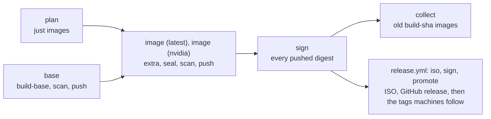

# How the build works

Four Containerfiles, run by the [`Justfile`](../../Justfile)'s recipes, the
same way locally and in CI. The features they build from are in
[`features/`](../../features/README.md) (the OS) and
[`extras/`](../../extras/README.md) (each extra).

| File                                                                 | Builds                                 | Tag (`localhost/fedora-bootc`) |
| -------------------------------------------------------------------- | -------------------------------------- | ------------------------------ |
| [`image/base.Containerfile`](../../image/base.Containerfile)         | the OS, unsealed                       | `latest`                       |
| [`image/extra.Containerfile`](../../image/extra.Containerfile)       | an extra on top of it                  | `<extra>`, such as `nvidia`    |
| [`image/seal.Containerfile`](../../image/seal.Containerfile)         | any of those, sealed into a signed UKI | `<name>-uki`                   |
| [`installer/live.Containerfile`](../../installer/live.Containerfile) | the live ISO's system                  | `live`                         |

`just build` runs `build-base`, then `seal latest`. `just build nvidia
[closed]` runs `build-base`, `build-extra nvidia` and `seal nvidia`. The tags are the registry's ([updates.md](updates.md)).

## Stages

**`features`** runs [`image/features.sh`](../../image/features.sh): it checks
the features (hooks that can run, no file shipped twice, an extra's against
the OS's too), then sorts them. Each later step gets only its part, which is
what keeps the cache useful (below).

**`builds`** runs every OS feature's `build.sh`
([`image/builds.sh`](../../image/builds.sh)): what Fedora does not package,
built from pinned upstream versions (noctalia-greeter as an RPM, shimmy as a
binary). It starts from the same base as the image, with Fedora's updates
applied like the image does, so the results link against the libraries the
image ships, and it is thrown away, so no toolchain reaches the image. A new
build needs no change outside its feature's folder.

**`enroll`** signs the Secure Boot enrollment sets
([`image/enroll.sh`](../../image/enroll.sh)): `PK.auth`, `KEK.auth` and
`db.auth`, the signed EFI variables a machine enrolls from systemd-boot's
menu ([secureboot-tpm2.md](../secureboot-tpm2.md)), once with Microsoft's
certificates (`keys/microsoft/`) and once without. The one step with the PK
and KEK keys, and no network; it is thrown away, and the OS takes the files
alone. Each file is read back by separate code
([`image/sbauth.py`](../../image/sbauth.py)) the way the firmware will:
signer, attributes, timestamp, and exactly the expected certificates.

**`os`** is the whole OS, an ordinary bootc image with its kernel in place:

1. Every stable Fedora update (`dnf upgrade`), then the comps groups
   (Workstation's base set, without GNOME), then a record of the security
   advisories that dnf knew, which the scan goes by: gigabytes that rarely
   change, in a layer of their own.
2. [`packages.sh`](../../image/packages.sh): each feature's `pre-install.sh`,
   then every package of every feature in one dnf transaction (plus the
   RPMs the builds made), then each `post-install.sh`. The expensive layer.
3. [`bootloader.sh`](../../image/bootloader.sh): GRUB and bootupd out,
   systemd-boot in, signed with the Secure Boot key.
4. The features' `overlay/` trees, the files the builds made, the cosign
   public key and the enrollment sets (to
   `/usr/lib/bootc/install/secureboot-keys/`, where `bootc install` finds
   them) are copied in.
5. [`finalize.sh`](../../image/finalize.sh): the features' systemd presets,
   each `setup.sh` (its setup, then its checks), then checks of the image as
   a whole.

**`extra`** runs steps 2, 4 and 5 again on top of the OS, for the extra
`EXTRA` names, with a signing step after 2: each feature's `sign.sh`
([`sign.sh`](../../image/sign.sh)), the one step of an extra with the Secure
Boot key, run with no network. `FLAVOR` reaches its `sign.sh` and
`setup.sh`. For nvidia: RPM Fusion's driver and the module's build tools,
then its kernel module built and signed against the image's kernel, open or
closed modules by flavor.

[`installer/live.Containerfile`](../../installer/live.Containerfile), the
live ISO's system, starts from the plain Fedora base, not the OS, with
Fedora's updates applied the same way: the installer pulls the real image
from the registry ([`installer/`](../../installer/)).

## Sealing

`just seal <name> [src]` seals a local bootc image (`src`, by default
`:<name>`) into `:<name>-uki` in three commands:

1. `podman build --target split`: [`initramfs.sh`](../../image/initramfs.sh)
   rebuilds the initramfs, `bootc container lint` runs, and the kernel and
   initramfs move out of the rootfs (`:<name>-split`, used by image ID from
   here on).
2. `podman run` of the pinned chunkah, with the split image read-only, an
   empty directory under `${TMPDIR:-/var/tmp}` (about 10 GB) and no network,
   rechunks the rootfs into the layers that get pushed; `podman pull oci:`
   imports them.
3. `podman build --target final`, with the import and the split image as
   build contexts: `uki` seals the composefs digest of the imported layers
   and the `kargs.d` kernel arguments into a UKI signed with the Secure Boot
   key ([`uki.sh`](../../image/uki.sh)), then checks, without the key, that
   the db of every enrollment set the image ships trusts that UKI and
   systemd-boot ([`uki-trust.sh`](../../image/uki-trust.sh)); `final` is the
   import plus that UKI in `/boot/EFI/Linux/`.

The digest has to come from the import: those are the layers `bootc
install` pulls, and with a digest computed from a build stage the UKI
refuses to boot. `image/seal.Containerfile` and the `seal` recipe have the
details.

## What reruns

Locally, each step is a cached layer; a change reruns its step and
everything after it. A CI job starts without a cache and builds what it
needs from scratch.

| Changed                                                                                                     | Reruns                                                                                                                                        |
| ----------------------------------------------------------------------------------------------------------- | --------------------------------------------------------------------------------------------------------------------------------------------- |
| nothing                                                                                                     | chunkah (seconds, the same layers); the rest is cached (the UKI step once more after a new split image)                                       |
| a feature's `setup.sh` or `overlay/` (except `etc/yum.repos.d/`)                                            | `finalize.sh` (seconds), then each extra from its package step, then the seals                                                                |
| a package list, a `.repo` file, `pre-install.sh` or `post-install.sh`                                       | the package step (minutes)                                                                                                                    |
| a feature's `build.sh` or the files next to it                                                              | every build, then the package step if a built RPM changed                                                                                     |
| an extra's folder (`extras/nvidia/`)                                                                        | that extra's image and its seal, and those of every extra that links to its features; its `sign.sh`, or another flavor, from the signing step |
| a Secure Boot certificate (a new key)                                                                       | the steps that sign: `bootloader.sh`, the enrollment sets, an extra's signing step, the UKI                                                   |
| `image/enroll.sh`, `image/sbauth.py`, `keys/microsoft/`                                                     | the enrollment sets (seconds); if their bytes change, `finalize.sh`, each extra from its package step and the seals                           |
| `image/initramfs.sh`                                                                                        | each seal from its split step; the unsealed images stay as they are                                                                           |
| `image/uki.sh`                                                                                              | the UKI step alone                                                                                                                            |
| `image/uki-trust.sh`, `image/sbauth.py`                                                                     | each seal's trust step alone                                                                                                                  |
| the Fedora base (daily; between its refreshes a local build keeps its cached updates step, CI has no cache) | everything                                                                                                                                    |
| docs, CI files                                                                                              | nothing: `.containerignore` keeps them out                                                                                                    |

## Keys

The private keys live outside the checkout, in the key directory
(`~/.local/share/fedora-bootc/keys`, [keys/README.md](../../keys/README.md)).
The Secure Boot keys and their certificates are podman secrets: the db key
is mounted only into the three steps that sign what boots, `bootloader.sh`,
an extra's signing step (nvidia's modules) and `uki`, and the PK and KEK
keys only into `enroll`, which has no network. `just check` fails on any
other step that mounts them, on an `enroll` step with a network or more
mounted than its own context, and on any step that mounts the build
context, which `.containerignore` keeps `keys/` out of, `cosign.pub` and
`microsoft/`'s certificates aside; it reads the Containerfiles as text, so
it refuses parser directives and variables in mount options too. The
cosign key reaches no build: CI signs after the push, in a job of its own
([updates.md](updates.md#signing)).

## What fails a build

- `features.sh`: a file shipped twice, a hook that cannot run, a file that
  is no feature file, a `build.sh` in an extra or a `sign.sh` in the OS, a
  feature link that leads nowhere or to a feature already there. An
  extra's overlay path that the OS already has (an extra replaces none of
  its files). `just images`: an extra named after a tag that is taken.
- `builds.sh`: a `build.sh` that fails, or two builds making the same file
  or RPM.
- A feature's checks (the end of its `setup.sh`, also what it needs from
  another feature) and `finalize.sh`'s
  image-wide ones: a built file that is also in an OS overlay, services, a
  private key left in the image, what the comps excludes keep out.
- `enroll.sh`: a PK or KEK key that is not its certificate's, or an
  enrollment set that does not read back as signed (signer, attributes,
  timestamp, certificates and their owners).
- `initramfs.sh`: plymouthd or its theme missing from the initramfs, and on
  the nvidia extra the nvidia modules (early KMS).
- `uki-trust.sh`: an enrollment set whose db does not trust the UKI or
  systemd-boot, which a machine that enrolled it could not boot.
- `bootc container lint`.
- In CI, before every seal: a chunkah pin its release workflow did not sign
  (`just verify-chunkah`). Before every push: the scan
  ([updates.md](updates.md#scanning)).

## Locally and in CI

|                | Locally                                    | CI ([`build.yml`](../../.github/workflows/build.yml))                                                                             |
| -------------- | ------------------------------------------ | --------------------------------------------------------------------------------------------------------------------------------- |
| which images   | `just images`                              | job `plan`: the matrix, and how many builds `collect` keeps                                                                       |
| unsealed OS    | `just build-base`                          | job `base`: built once per run, pushed as `build-<sha>`                                                                           |
| unsealed extra | `just build-extra nvidia [closed]`         | in its `image` job, pushed as `build-<sha>-nvidia`                                                                                |
| sealed         | `just build`, `just build nvidia [closed]` | job `image (<name>)`, one per image: `just build <name>` on the pushed base (`BASE_IMAGE`), pushed as `build-<sha>[-<extra>]-uki` |
| live ISO       | `just build-live`, `just iso`              | `release.yml`, and pull requests that touch it                                                                                    |

Each push goes through `.github/actions/publish` to one immutable
`build-<sha>...` tag. A push to main runs `build.yml` alone; the weekly
`release.yml` runs it first, then `iso`, `sign` (the live image) and
`promote`. Pull requests run `plan` and the `image` jobs, each building its
own OS with throwaway Secure Boot keys, and push nothing. Tags, signing and
releases: [updates.md](updates.md).
