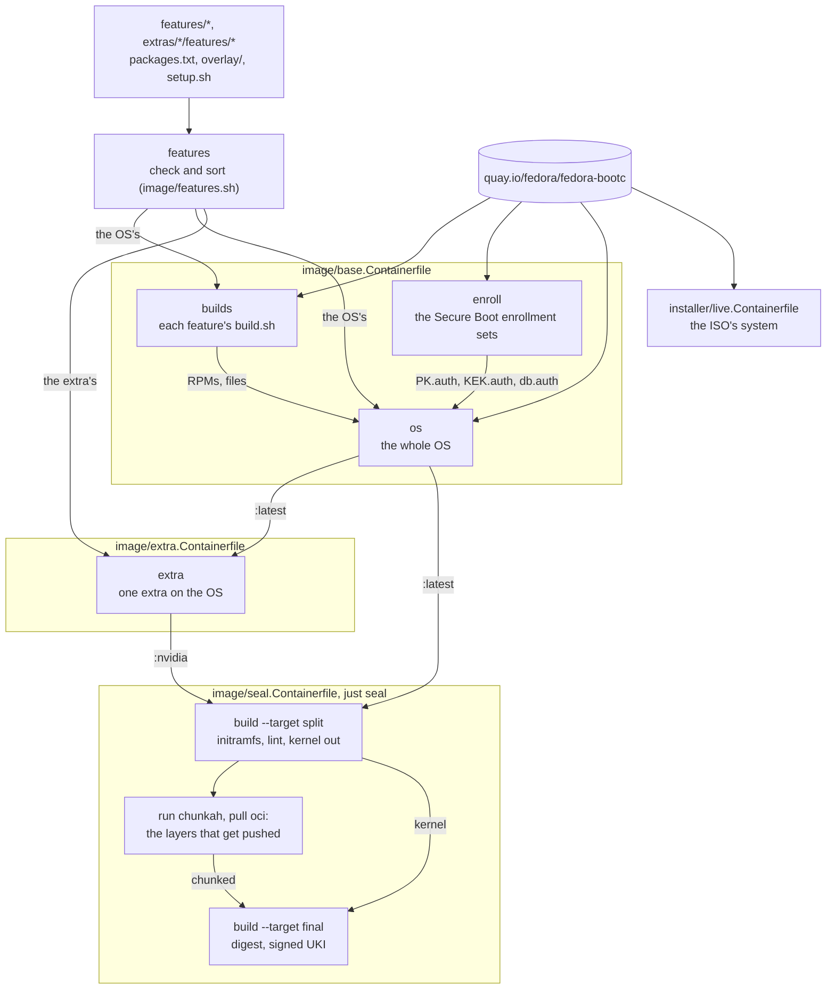
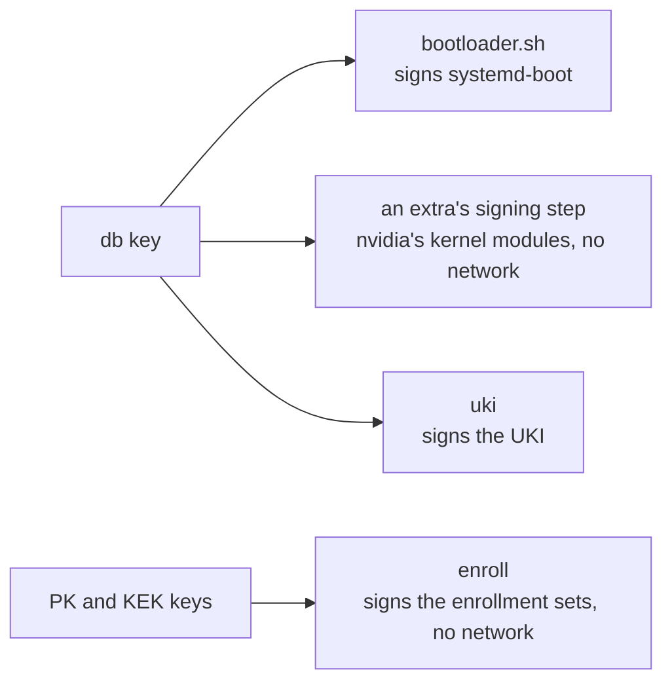

# How the build works

The [`Justfile`](../../Justfile) recipes build four Containerfiles the same way
locally and in CI, from [`features/`](../../features/) for the OS and
[`extras/`](../../extras/) for each extra. The local tags of
`localhost/fedora-bootc` match the registry's:

| File                                                                 | Builds                                                     | Local tag                          |
| -------------------------------------------------------------------- | ---------------------------------------------------------- | ---------------------------------- |
| [`image/base.Containerfile`](../../image/base.Containerfile)         | The OS, unsealed                                           | `latest`                           |
| [`image/extra.Containerfile`](../../image/extra.Containerfile)       | An extra on the OS                                         | The extra's name, such as `nvidia` |
| [`image/seal.Containerfile`](../../image/seal.Containerfile)         | Either one, sealed into a signed unified kernel image (UKI) | `latest-uki`, `nvidia-uki`         |
| [`installer/live.Containerfile`](../../installer/live.Containerfile) | The live ISO's system                                      | `live`                             |

`just build` runs `build-base`, then `seal latest`.
`just build nvidia [closed]` runs `build-base`, `build-extra nvidia`, and
`seal nvidia`.

## Build stages

These stages build every image:

**`features`** ([`image/features.sh`](../../image/features.sh)) checks the
features, an extra's together with the OS's, and sorts them. Each later step
gets only its own part, which keeps the cache useful.

**`builds`** ([`image/builds.sh`](../../image/builds.sh)) runs each OS
feature's `build.sh` to build what Fedora doesn't package, from pinned upstream
versions: noctalia-greeter as an RPM and shimmy as a binary. It starts from the
image's base with Fedora's updates, so the results link against the image's
libraries.

**`enroll`** ([`image/enroll.sh`](../../image/enroll.sh)) signs the Secure Boot
enrollment sets, one with Microsoft's certificates from `keys/microsoft/` and
one without. Each holds the signed EFI variables for the Platform Key (PK), Key
Exchange Key (KEK), and signature database (db), which
[`image/sbauth.py`](../../image/sbauth.py) checks as the firmware does. A
machine enrolls a set from the systemd-boot menu
([Enroll the keys](../secureboot-tpm2.md#enroll-the-keys)).

**`os`** is an ordinary bootc image with its kernel in place, built in five
steps:

1. Every stable Fedora update (`dnf upgrade`), the comps groups, including the
   Workstation base set without GNOME, and a record of the security advisories
   that dnf knew, for the scan.
2. [`image/packages.sh`](../../image/packages.sh): each feature's
   `pre-install.sh`, then every feature's packages and the built RPMs in one
   dnf transaction, then each `post-install.sh`.
3. [`image/bootloader.sh`](../../image/bootloader.sh): systemd-boot, signed
   with the db key, replaces GRUB and bootupd.
4. The features' `overlay/` trees, the built files, the cosign public key, and
   the enrollment sets in `/usr/lib/bootc/install/secureboot-keys/`, where
   `bootc install` finds them.
5. [`image/finalize.sh`](../../image/finalize.sh): the features' systemd
   presets, each `setup.sh`, and checks of the image as a whole.

**`extra`** builds the extra that the `EXTRA` build argument names. It repeats
steps 2, 4, and 5 for its features, with a signing step after step 2:
[`image/sign.sh`](../../image/sign.sh) runs each feature's `sign.sh`, such as
nvidia's, which builds and signs kernel modules for the image's kernel. The
`FLAVOR` build argument, such as `closed`, reaches `sign.sh` and `setup.sh`.

[`installer/live.Containerfile`](../../installer/live.Containerfile) starts
from the plain Fedora base with Fedora's updates, not from the OS, because the
[installer](../../installer/) pulls the OS image from the registry.

## Sealing

`just seal NAME [SRC]` seals `SRC`, by default `localhost/fedora-bootc:NAME`,
into `NAME-uki` in three commands:

1. `podman build --target split`:
   [`image/initramfs.sh`](../../image/initramfs.sh) rebuilds the initramfs,
   `bootc container lint` runs, and the kernel and initramfs move out of the
   rootfs. The result is `NAME-split`.
2. `podman run`: the pinned chunkah rechunks the rootfs into layers, with the
   split image read-only, no network, and an empty directory under
   `${TMPDIR:-/var/tmp}` that needs about 10 GB. Then `podman pull oci:`
   imports them.
3. `podman build --target final`: the `uki` stage seals the composefs digest of
   the imported layers and the `kargs.d` kernel arguments into a UKI signed
   with the db key ([`image/uki.sh`](../../image/uki.sh)). Then
   [`image/uki-trust.sh`](../../image/uki-trust.sh) checks that every
   enrollment set trusts the UKI and systemd-boot. The `final` stage is the
   import plus that UKI in `/boot/EFI/Linux/`.

> [!IMPORTANT]
> The digest must come from the import, because `bootc install` pulls those
> layers. With a digest computed from a build stage, the UKI refuses to install
> or boot ("wrong composefs= parameter").

## Caching

CI jobs have no cache. Locally, each step is a cached layer, and a change
reruns its step and every later one. A change to the OS image also reruns
each extra from its package step, and the seals:

| Change                                                                             | Reruns                                                                                               |
| ---------------------------------------------------------------------------------- | ---------------------------------------------------------------------------------------------------- |
| Nothing                                                                            | Only chunkah and the import, in seconds                                                              |
| An OS feature's `setup.sh` or `overlay/`, except `etc/yum.repos.d/`                | `finalize.sh` (seconds)                                                                              |
| An OS feature's package list, `.repo` file, `pre-install.sh`, or `post-install.sh` | The package step (minutes)                                                                           |
| An OS feature's `build.sh` or the files next to it                                 | Every build, then the package step if a built RPM changed, or `finalize.sh` if only a built file did |
| An extra's folder, such as `extras/nvidia/`                                        | That extra and every extra that links to its features, with their seals                              |
| An extra's `sign.sh` or `FLAVOR`                                                   | That extra from its signing step, and its seal                                                       |
| The db certificate                                                                 | `bootloader.sh` and the enrollment sets                                                              |
| The PK or KEK certificate, or `keys/GUID`                                          | The enrollment sets, then `finalize.sh`                                                              |
| `image/enroll.sh`, `image/sbauth.py`, or `keys/microsoft/`                         | The enrollment sets (seconds), then `finalize.sh` if their bytes change                              |
| `image/initramfs.sh`                                                               | Each seal from its split step                                                                        |
| `image/uki.sh`                                                                     | Each seal's `uki` stage                                                                              |
| `image/uki-trust.sh` or `image/sbauth.py`                                          | Each seal's trust step                                                                               |
| The Fedora base image, refreshed daily                                             | Everything; between refreshes, a local build keeps its cached Fedora updates                         |
| Docs or CI files                                                                   | Nothing: `.containerignore` keeps them out                                                           |

## Signing keys

The private keys live outside the checkout
([Key locations](../../keys/README.md#key-locations)). A build gets the Secure
Boot keys and certificates as podman secrets, which never enter a layer. It
mounts each key only into the steps that sign with it:

The db certificate also goes to `enroll`, for `db.auth`. `just check` fails on
any of these:

- A Secure Boot secret mounted into any other step.
- An `enroll` step with a network, or with more mounted than its own context.
- A step that mounts the build context, because such a mount ignores
  `.containerignore` and can read all of `keys/`.
- A parser directive or a variable in a mount option, because `just check`
  reads the Containerfiles as plain text.

The cosign key never reaches a build. CI signs after the push, in its own job
([Signing](updates.md#signing)).

## Build checks

These checks fail a build:

- `image/features.sh`: a file shipped twice, a hook that can't run, a file
  that isn't a feature file, a `build.sh` in an extra or a `sign.sh` in the
  OS, or a feature link that leads nowhere or to a feature already there.
- `image/extra.Containerfile`: an extra's overlay path that the OS already
  has.
- `just images`: an extra name that isn't a valid tag or is a tag already
  taken.
- `image/builds.sh`: a `build.sh` that fails, or two builds that make the same
  file or RPM.
- Each `setup.sh`: its checks, including what its feature needs from another.
- `image/finalize.sh`: a built file that's also in an OS overlay, a unit that
  isn't in the state its preset names, a private key left in the image, or a
  second desktop or LibreOffice.
- `image/enroll.sh`: a PK or KEK key that doesn't match its certificate, or an
  enrollment set that `image/sbauth.py` rejects.
- `image/initramfs.sh`: an initramfs without plymouthd or its theme, or, on
  the nvidia extra, without the nvidia modules for early kernel mode setting.
- `image/uki-trust.sh`: an enrollment set whose db doesn't trust the UKI or
  systemd-boot, so a machine that enrolled it couldn't boot.
- `bootc container lint`: a lint error.
- `just verify-chunkah`, in CI before each `image` job's build: a chunkah pin
  that its release workflow didn't sign.
- The scan, in CI before every push ([Scanning](updates.md#scanning)).

## Local and CI builds

Each push in [`build.yml`](../../.github/workflows/build.yml) goes through
[`.github/actions/publish`](../../.github/actions/publish/action.yml) to one
immutable tag, where `SHA` is the commit's seven-character short hash:

| Build          | Local                                      | CI                                                                                                                          |
| -------------- | ------------------------------------------ | --------------------------------------------------------------------------------------------------------------------------- |
| Image list     | `just images`                              | Job `plan`: the matrix, and how many `build-SHA` images `collect` keeps                                                     |
| Unsealed OS    | `just build-base`                          | Job `base`, once per run, pushed as `build-SHA`                                                                             |
| Unsealed extra | `just build-extra nvidia [closed]`         | Its `image` job, pushed as `build-SHA-nvidia`                                                                               |
| Sealed         | `just build`, `just build nvidia [closed]` | Job `image (NAME)`: `just build NAME` on the pushed base (`BASE_IMAGE`), pushed as `build-SHA-uki` or `build-SHA-NAME-uki`  |
| Live ISO       | `just build-live`, `just iso`              | `release.yml`, and `ci.yml` for pull requests that change it                                                                |

A push to `main` runs these jobs, and the weekly `release.yml` runs them before
its own:

Pull requests that can affect the images run `plan` and the `image` jobs, each
building its own OS with throwaway Secure Boot keys, and push nothing. For
tags, signing, and releases, see [Updates, scanning, and CI](updates.md).
