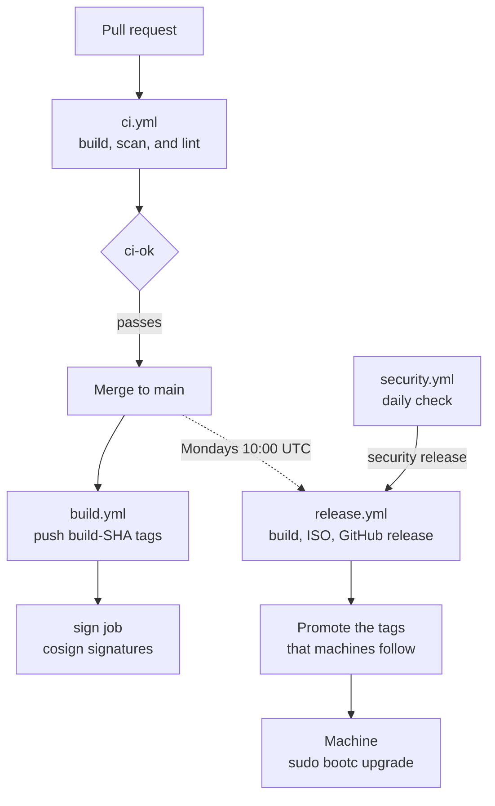

# Updates, scanning, and CI

This page explains how changes reach machines and what keeps images current
and safe.

## From a commit to a machine

A change goes through these stages:



Each stage works as follows:

1. On a pull request (PR), `ci.yml` builds and scans the images, unsealed and
   sealed, and the live ISO when the PR can affect them, and rehearses signing
   and promotion.
   Its `ci-ok` job is the only required check.
2. On a push to `main`, `build.yml` builds and pushes the image, unsealed
   and sealed, as `build-SHA` and `build-SHA-uki`, where `SHA` is the short
   commit hash. It keeps about two builds' worth of these images, a
   release's `build-SHA-live` included.
3. Each Monday, `release.yml` publishes a release named `YEAR.WEEK`, the ISO
   year and week, such as `26.36`, and moves the tags that machines follow to
   its build: `latest`, `latest-uki`, and `live`, and the former NVIDIA
   image's `nvidia` and `nvidia-uki` along with `latest` and `latest-uki`. A
   second release in the same week is `YEAR.WEEK.N`, such as `26.36.1`. To
   release sooner, click **Actions** > **release** > **Run workflow**.
4. On a machine, `sudo bootc upgrade` checks the cosign signature of the tag
   that the machine follows against the key in the image, and stages the image
   for the next boot. Nothing else updates a machine: the image masks bootc's
   automatic update timer (`features/updates/`). The first boot of an image
   with a newer systemd-boot puts it on the EFI system partition
   (`features/boot/`). For the commands, see
   [Operating system](../../README.md#operating-system).

## Signing

The job that builds and scans an image pushes it unsigned. Then `sign` jobs,
the only jobs with the cosign key, sign every digest that the run pushed and
verify each the way a machine does
([`.github/actions/sign`](../../.github/actions/sign/)). They run nothing but
checkout, the artifact download, and cosign.

The Secure Boot keys reach only the build jobs of runs that push images. The
`image` job gets the signature database (db) key, and only the `enroll` job
gets the Platform Key (PK) and Key Exchange Key (KEK), which sign the
enrollment sets. Pull requests get none. All these keys are secrets of the
`release` environment, which only `main` and the release tags can use, and a
push build fails if one is missing. To set up the environment, see
[Create your own fork](../fork.md).

An unsigned tag is unusable: machines refuse it, and a release promotes only
what it verifies. Machines also refuse a dev container that the cosign key
didn't sign
([`policy.json`](../../features/updates/overlay/etc/containers/policy.json)).

## Dependency updates

Fedora packages come from `quay.io/fedora/fedora-bootc` at the release that the
Containerfiles name. Every build first runs `dnf upgrade`, so it's current on
the day it runs, however old the base image is.
[`image/groups.sh`](../../image/groups.sh) explains why.

Daily, `security.yml` checks the published sealed images and `live` for missing
critical Fedora security updates that have been stable in
[Bodhi](https://bodhi.fedoraproject.org/) for 12 hours, long enough to reach the
mirrors. The `GATE` variable in
[`.github/actions/scan-image/advisories.sh`](../../.github/actions/scan-image/advisories.sh)
sets which severities count. For those updates, `security.yml` starts a
security release: `release.yml` releases the head of `main` as the week's next
free version, normally `YEAR.WEEK.N`. Every image must contain the updates, or
the release fails and the next day's check retries it. Either way,
`release.yml` opens an issue labeled `security-release` that tells the
repository owner what the release fixed and what to run, or that it failed.

Renovate keeps the other pins current: GitHub Actions, the chunkah image, what
features build from source (noctalia-greeter and shimmy), and CI's tools, such
as `just`, `gh`, and `trivy`. [`renovate.json`](../../renovate.json) handles
each kind of update as follows:

| Update                                                        | Pull request                                                                           | Who merges                  |
| ------------------------------------------------------------- | -------------------------------------------------------------------------------------- | --------------------------- |
| Minor, patch, or digest                                       | One for all, `renovate/weekly`                                                         | GitHub, once `ci-ok` passes |
| Minor or patch in a feature's `build.sh`                      | One per dependency                                                                     | GitHub, once `ci-ok` passes |
| Major                                                         | One each                                                                               | Repository owner            |
| Next Fedora release                                           | One for all Fedora pins, once [endoflife.date](https://endoflife.date/fedora) lists it | Repository owner            |
| GitHub Action or noctalia-greeter tag moved to another commit | One for actions, one for noctalia-greeter, labeled `security`, at once                 | Repository owner            |

Pull requests open on weekends unless the table says otherwise. Automatic
merges wait until an update is 3 days old, except for container image pins.

A PR that changes a pin in
[`.github/actions/install-tools/tools.txt`](../../.github/actions/install-tools/tools.txt)
also checks it against what upstream signs or attests for that version, except
`just`, which publishes only a checksum. To run the check locally with `cosign`
and a signed-in `gh`, run:

```sh
.github/actions/install-tools/verify-pins.sh .github/actions/install-tools/tools.txt
```

## Failure notifications

A failed workflow run on `main` opens an issue assigned to the repository
owner (`notify.yml`), and the workflow's next successful run closes it.
Renovate assigns the repository owner any automerge PR whose checks fail. A
release published by hand runs on its tag, so only GitHub's email to the
publisher reports its failure.

## Scanning

[`.github/actions/scan-image`](../../.github/actions/scan-image/) scans every
container image right before it's pushed, and on pull requests. It runs trivy
only in rootless containers with no secret or token, and the scan itself has no
network access. The build fails on any of these:

- A secret anywhere in the image
- Known malicious code (CWE-506) anywhere in the image
- A critical Fedora security update that the image lacks although its build's
  dnf knew it, or, in a security release, one that the release is for
- A critical vulnerability with a fix, in a file that the image adds itself
  rather than through an RPM or a pinned upstream release

A Fedora update that reached the mirrors after the build read them only warns,
as do missing Fedora updates on pull requests.

The job log has every trivy finding. Outside pull requests, findings that need
action, pending critical and important Fedora updates included, also become
code scanning alerts on the **Security** tab, which close once a build no
longer has them. `alerts.yml` assigns each unassigned alert to the repository
owner, so GitHub emails them.

To scan a local image, run:

```sh
.github/actions/install-tools/install.sh /tmp/scan trivy
TRIVY=/tmp/scan/bin/trivy .github/actions/scan-image/scan.sh localhost/fedora-bootc:latest-uki
```

## Workflows

This table lists the workflows in `.github/workflows/`:

| Workflow       | Trigger                                                                                         | What it does                                                                         |
| -------------- | ----------------------------------------------------------------------------------------------- | ------------------------------------------------------------------------------------ |
| `ci.yml`       | Every PR; pushes to `main` that change `.github/`, `renovate.json`, `scripts/`, or `installer/` | Lint (actionlint, zizmor), pin checks, a signing rehearsal, and the `ci-ok` gate     |
| `build.yml`    | Pushes to `main` that change the image; by hand; from `release.yml` and `ci.yml`                | Builds and signs `build-SHA` images                                                  |
| `release.yml`  | Mondays 10:00 UTC; by hand; from `security.yml`; a release published by hand                    | Builds images and the ISO, publishes the release, and moves the tags machines follow |
| `security.yml` | Daily 15:23 UTC; by hand                                                                        | Starts a security release for a missing critical Fedora update                       |
| `alerts.yml`   | After `build.yml` and `release.yml`; daily; by hand                                             | Assigns code scanning alerts to the repository owner                                 |
| `notify.yml`   | After the others on `main`                                                                      | Opens and closes the failure issues                                                  |
