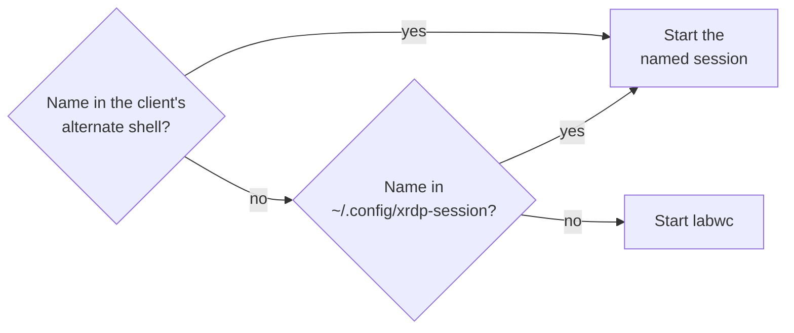

# OS overview

For what the image contains, see
[Operating system](../README.md#operating-system).

Desktop apps are Flatpaks from Flathub, and none are preinstalled. For an app
store, install Bazaar:

```sh
flatpak install flathub io.github.kolunmi.Bazaar
```

For development tools, which the host lacks, see
[Build the images](../README.md#build-the-images).

## Remote desktop (XRDP)

XRDP listens on port 3389. Log in with your normal account, not root. Enter
the username and password in the client: XRDP has no login screen, and closes
a connection without valid credentials. It accepts TLS connections only. The
session is labwc unless you name `niri`, `sway`, `river`, or `wayfire`. The
niri session needs a GPU. The name can go in two places:



In Remmina, the alternate shell is **Advanced** > **Start-up program**. In
xfreerdp, it's the `/shell` option, such as `/shell:sway`. For the desktop to
follow Remmina's window size, turn on **Dynamic resolution update** and
**Use initial window size**. Sessions log to `~/.xrdp-session.log`. For
details, see
[`features/xrdp/overlay/etc/xrdp/startwm.sh`](../features/xrdp/overlay/etc/xrdp/startwm.sh).

A client asks once whether to trust the machine's own XRDP certificate.
Compare the fingerprint it shows with this command's output, using `-sha1`
instead of `-sha256` for Windows clients:

```sh
sudo openssl x509 -noout -fingerprint -sha256 -in /etc/xrdp/cert.pem
```

## Virtual machines

Virtual Machine Manager (`virt-manager`) and `virt-install` use the system's
libvirt (`qemu:///system`). Accounts the installer created can manage VMs
without a password. For another account, run this command and log in again:

```sh
sudo usermod -aG libvirt USERNAME
```

## Local LLM

The [shimmy](https://github.com/Michael-A-Kuykendall/shimmy) server runs GGUF
models on the GPU with its WebGPU engine through Vulkan, behind an
OpenAI-compatible API at `http://127.0.0.1:11435/v1`. To turn it on for your
account, run:

```sh
mkdir -p ~/.local/share/shimmy/models    # put .gguf files here
systemctl --user enable --now shimmy
curl http://127.0.0.1:11435/v1/models
```

The server also finds models in `~/models` and the Hugging Face, Ollama, and
LM Studio caches. The VS Code Flatpak reaches it at the same address.

> [!WARNING]
> On some GPUs, a request can hang the GPU until the kernel resets it.

## Defaults

- Nothing updates a machine by itself: the image masks bootc's automatic
  update timer. To update, see
  [Operating system](../README.md#operating-system).
- Boot shows a splash screen. To see the boot messages, press Esc. To show the
  boot menu, hold Space at power-on.
- The first boot of an image with a newer systemd-boot puts it on the EFI
  system partition. `journalctl -b -u systemd-boot-update` shows what it did.
- SSH accepts passwords for users and only keys for root, and fail2ban bans
  hosts after repeated failed logins over SSH or XRDP.
- Every session has gcr's SSH agent, which offers the keys in `~/.ssh`. For a
  key with a passphrase, run `ssh-add` once after login. Flatpaks with SSH
  access, such as VS Code, sign through the agent.
- To clone private GitHub repositories, sign in once with `gh auth login` and
  choose HTTPS for Git operations. The GitHub CLI keeps its token in the login
  keyring and sets up `git clone` and `gh repo clone`.
- To open an SMB share, such as a Windows folder or a NAS, press Ctrl+L in
  Files (Nautilus) and enter `smb://SERVER/SHARE`. The image is a client only
  and doesn't share its own folders.
- To turn on Tailscale, run
  `sudo systemctl enable --now tailscaled && sudo tailscale up`.
- To turn on Cockpit, the web admin interface, run
  `sudo systemctl enable --now cockpit.socket` and open
  <http://localhost:9090>. It listens on loopback only. From another machine,
  tunnel to it with `ssh -L 9090:localhost:9090 USERNAME@MACHINE`. It has no
  page for docker containers, and its Metrics page is off.

## NVIDIA driver

The image includes the NVIDIA driver from RPM Fusion
([`features/nvidia/`](../features/nvidia/)), with the open kernel modules,
which support GTX 16 / RTX 20 series GPUs and newer. On a machine without an
NVIDIA GPU, the kernel modules don't load, and OpenGL and Vulkan programs use
Mesa. An older NVIDIA GPU, which the driver doesn't support, gets the
`nouveau` driver instead, once the system has started; the boot splash says so
on every boot.

A machine that follows the former `nvidia-uki` or `nvidia` tag keeps getting
updates: each release moves them along with `latest-uki` and `latest`. To
follow `latest-uki` itself, run:

```sh
sudo bootc switch ghcr.io/lucarickli/fedora-bootc:latest-uki
```

The signed kernel modules load with Secure Boot on. This is untested on
hardware. To check it, see
[NVIDIA kernel modules](secureboot-tpm2.md#nvidia-kernel-modules).

> [!IMPORTANT]
> When you [enroll the Secure Boot keys](secureboot-tpm2.md#enroll-the-keys),
> choose the `fedora-bootc-and-microsoft` set for a machine with an NVIDIA
> card. Microsoft signs the card's firmware, and without that set, the card
> might show no picture before the OS starts.
