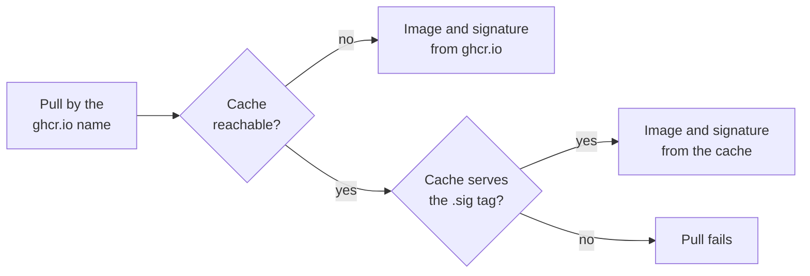

# Pull images through a cache

Installs and updates can pull the fedora-bootc image through a pull-through
cache or another registry mirror. The image keeps its `ghcr.io` name, so
pulls still check its cosign signature.

## Run the cache

The cache must allow anonymous pulls and serve cosign's `sha256-DIGEST.sig`
tags. The CNCF Distribution registry in proxy mode does both. To run it with
podman:

```sh
podman run -d --name ghcr-cache -p 5000:5000 -v ghcr-cache:/var/lib/registry \
    -e REGISTRY_PROXY_REMOTEURL=https://ghcr.io docker.io/library/registry:3
```

Open TCP port 5000 in the cache machine's firewall. The cache then serves plain
HTTP at `http://CACHE_HOST:5000`, where `CACHE_HOST` is the machine's hostname
or IP address.

A pull looks for the signature only where the image came from:



## Install through the cache

When you [install from the live ISO](install.md#install-from-the-live-iso),
press `e` in the boot menu, append the argument `fedora-bootc.mirror=ADDRESS`
to the `linux` line, and press Ctrl+X. `ADDRESS` stands in for `ghcr.io` in the
image name. Its host needs a dot or a port, and its path must be lowercase. For
a plain-HTTP cache, start it with `http://`. For example:

| Argument                                     | Image location                                   |
| -------------------------------------------- | ------------------------------------------------ |
| `fedora-bootc.mirror=http://192.0.2.10:5000` | `192.0.2.10:5000/lucarickli/fedora-bootc`        |
| `fedora-bootc.mirror=cache.example.com/ghcr` | `cache.example.com/ghcr/lucarickli/fedora-bootc` |

To see which mirror the live system uses, or why it ignored the argument,
press Ctrl+Alt+F2 and run:

```sh
sudo journalctl -b -u installer-mirror
```

## Installed systems

The live ISO copies its two mirror files into the installed system:

```text
/etc/containers/registries.conf.d/50-fedora-bootc-mirror.conf
/etc/containers/registries.d/50-fedora-bootc-mirror.yaml
```

With them, `bootc upgrade`, `bootc switch` to another tag, and `podman pull`
of this image keep using the cache. To move to another cache, edit both
files. To pull from `ghcr.io` again, delete them. Other images need their own
`[[registry]]` block to use a cache; see `man containers-registries.conf`.

> [!WARNING]
> On every network a machine joins, whoever answers at its plain-HTTP cache's
> address can hold back updates or serve an older signed image. On a machine
> that changes networks, use HTTPS or delete both files after installing.

## Configure a manual install

1. On the live system, run these commands in bash, with `m` set to the
   image's location in the cache:

   ```sh
   m=192.0.2.10:5000/lucarickli/fedora-bootc
   sudo tee /etc/containers/registries.conf.d/50-fedora-bootc-mirror.conf > /dev/null << EOF
   [[registry]]
   prefix = "ghcr.io/lucarickli/fedora-bootc"
   location = "ghcr.io/lucarickli/fedora-bootc"

   [[registry.mirror]]
   location = "$m"
   insecure = true    # plain HTTP only: drop this line for HTTPS
   EOF
   sudo tee /etc/containers/registries.d/50-fedora-bootc-mirror.yaml > /dev/null << EOF
   docker:
     $m:
       use-sigstore-attachments: true
   EOF
   ```

2. Follow
   [Install manually from a live USB drive](install.md#install-manually-from-a-live-usb-drive),
   and keep the `ghcr.io` name in every command. The installed system updates
   from, and checks the signature of, the name it was installed as.
3. After the first boot, run the same commands in bash on the installed system.
