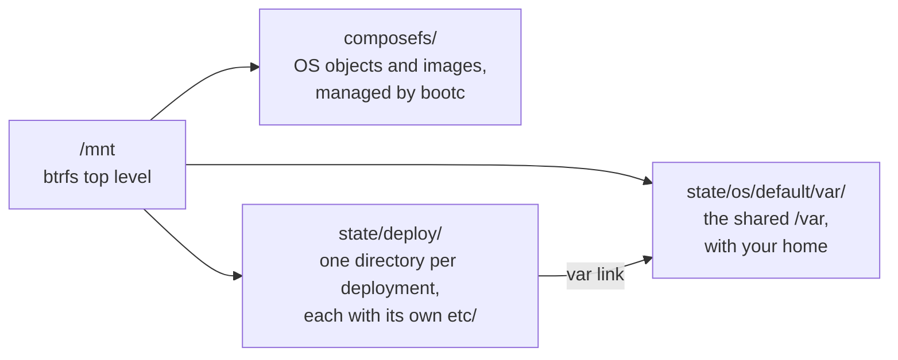

# Recover a system

First, try the previous deployment: hold Space at power-on and pick it in the
systemd-boot menu, or run `sudo bootc rollback` from a working boot. To see the
boot messages, press Esc during the boot splash.

If nothing boots, start a live Linux system, with Secure Boot off unless
Microsoft signed it and you enrolled the `fedora-bootc-and-microsoft`
[enrollment set](secureboot-tpm2.md#enroll-the-keys).

As root, run these commands, replacing `/dev/nvme0n1p2` with your root
partition. Without LUKS, skip `cryptsetup` and mount the partition itself:

```sh
lsblk                                 # find the partitions
cryptsetup open /dev/nvme0n1p2 root   # if encrypted
mount /dev/mapper/root /mnt           # btrfs top level, no subvolumes
ls /mnt                               # boot composefs ostree state
ls /mnt/composefs
ls /mnt/state/deploy/
ls /mnt/state/os/default/var/home
```

The composefs layout differs from the ostree layout most guides describe:



Copy your data out of `/mnt/state/os/default/var/`. Don't edit the OS in
`/mnt/composefs` or the unified kernel images (UKIs) on the EFI system
partition.

A dracut emergency shell usually means the disk doesn't match the kernel
arguments sealed into the UKI; see [Disk layout](install.md#disk-layout). In
the shell, `journalctl -b` shows what failed, and the keymap is Swiss (`ch`).

To repair the system, copy your data out, and then reinstall as described in
[Install fedora-bootc](install.md). To inspect the image's userspace without
booting it, run
`podman run -it ghcr.io/lucarickli/fedora-bootc:latest /bin/bash`.
