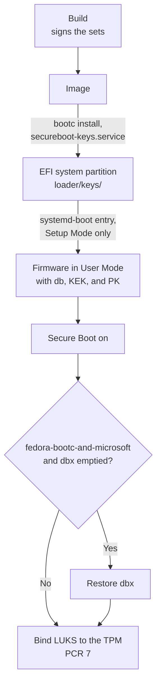

# Set up Secure Boot and TPM2 auto-unlock

After the installed machine boots, enroll the image's
[Secure Boot keys](../keys/README.md). Firmware without a Platform Key (PK) is
in Setup Mode, which enforces nothing, and enrolling a PK switches it to User
Mode. The TPM unlocks the disk only while Platform Configuration Register
(PCR) 7, which measures the Secure Boot state, is unchanged since binding.
Enrolling keys and updating the forbidden signature database (dbx) change
PCR 7, so bind the LUKS volume to the TPM last:



## Enroll the keys

The image's two enrollment sets hold the PK, the Key Exchange Key (KEK), and
the signature database (db) as signed EFI variables. They differ in what they
trust:

| Set                          | Trusts                                  | Use for                                                                          |
| ---------------------------- | --------------------------------------- | -------------------------------------------------------------------------------- |
| `fedora-bootc-and-microsoft` | The image's db and what Microsoft signs | Most machines: dual boot, an NVIDIA card, any graphics, network, or storage card |
| `fedora-bootc-only`          | The image's db alone                    | Machines that start nothing else: no Windows, no other USB drive                 |

Microsoft signs the Windows boot manager, other bootloaders such as shim, and
the firmware of add-in cards, called option ROMs. In
`fedora-bootc-and-microsoft`, Microsoft's KEK can also update db and dbx.

`fedora-bootc-only` blocks option ROMs, so a discrete graphics card might show
no picture before the OS starts, and a network or storage card can disappear
from the firmware.

At every boot, `secureboot-keys.service` copies the running image's sets to
the EFI system partition (ESP) if they differ. It also removes
`fedora-bootc-only` from the ESP if the TPM event log shows that an option ROM
ran. `journalctl -b -u secureboot-keys` shows what it did during this boot.

> [!WARNING]
> Without a TPM, or before the installed OS first starts, nothing removes
> `fedora-bootc-only`. Choose it only if the display and the boot disk work
> without add-in cards, such as integrated graphics and an onboard NVMe drive,
> and you know how to clear the keys in the firmware setup. If you're unsure,
> choose `fedora-bootc-and-microsoft`.

To enroll a set, follow these steps:

1. Rehearse in a VM on the build host, after you
   [build the images](../README.md#build-the-images):

   ```sh
   just qcow2
   just vm-enroll        # or: just vm-enroll fedora-bootc-only
   ```

2. Have the LUKS passphrase ready: the TPM stops unlocking the disk until you
   bind it again. On a dual-boot machine, also suspend BitLocker first, or
   have its recovery key ready.

3. In a host shell, not a toolbox, select the set for the next boot and reboot
   into the firmware setup:

   ```sh
   sudo bootctl set-oneshot secure-boot-keys-fedora-bootc-and-microsoft   # or secure-boot-keys-fedora-bootc-only
   sudo systemctl reboot --firmware-setup
   ```

   If `bootctl status` shows `Boot into FW: not supported`, run
   `sudo systemctl reboot` instead and press the setup key at power-on. If it
   shows `Secure Boot: disabled (setup)`, the firmware is already in Setup
   Mode. Run `sudo systemctl reboot` instead, and skip step 4.

4. Put the firmware in Setup Mode. Menu names vary by vendor, so look for
   options such as these:

   - On AMI firmware, first turn off **Factory Key Provision**, which would
     restore the factory keys at the next start.
   - If possible, delete only the PK, which keeps dbx. For example, select
     **Key Management** > **Platform Key** > **Delete** on AMI firmware, or
     **Reset to Setup Mode** on Lenovo firmware.
   - Otherwise, use an option such as **Clear all keys**, **Delete all
     Secure Boot variables**, or AMI's **Reset To Setup Mode**. These also
     empty dbx, which step 7 restores.

   Turn on **Secure Boot** here or in step 6, then save and exit.

5. systemd-boot shows
   `Warning: Enrolling custom Secure Boot keys might soft-brick your machine!`
   and counts down 15 seconds. To abort without writing anything, press any
   key. Otherwise, systemd-boot writes db, KEK, and PK, and reboots.

   To enroll by hand, hold Space at power-on and select the set's
   **Enroll Secure Boot keys** entry. It appears last, and only in Setup Mode.
   With **Fast Boot** on, the firmware might ignore the keyboard.

   If something else happens:

   - The OS starts, and `bootctl status` shows `Secure Boot: disabled (setup)`.
     Either systemd-boot started before the firmware was in Setup Mode and
     used up the one-shot, or it failed to write the keys. Retry without
     step 4: enroll by hand, which shows any error, such as
     `Failed to write ...`, or run the `bootctl set-oneshot` command from
     step 3, then `sudo systemctl reboot`.
   - The OS starts, and `mokutil --pk` shows the firmware's factory keys.
     Turn off **Factory Key Provision** or its equivalent, and start again at
     step 3.
   - The firmware reports a Secure Boot violation, or Windows starts: the
     firmware isn't in Setup Mode. Press the setup key at power-on and repeat
     step 4, because the one-shot is still set. To start the OS without
     enrolling the keys, turn Secure Boot off, and later start again at
     step 3.

6. Check that Secure Boot is on with the image's keys:

   ```sh
   mokutil --sb-state          # SecureBoot enabled
   bootctl status              # Secure Boot: enabled (user)
   mokutil --pk | grep -i 'sha1 fingerprint'
   ```

   The fingerprint must match what
   `openssl x509 -noout -fingerprint -sha1 -in keys/PK/PK.pem` shows in the
   repository. If Secure Boot is still disabled, turn it on in the firmware
   setup.

7. If step 4 or an earlier reset to Setup Mode, such as one before you
   installed, emptied dbx, restore it before you bind the TPM. The sets carry
   no dbx, so until then, `fedora-bootc-and-microsoft` trusts what Microsoft
   has revoked. `fedora-bootc-only` needs none. To restore dbx, run:

   ```sh
   fwupdmgr refresh && fwupdmgr update
   fwupdmgr get-devices          # the UEFI dbx device's version
   ```

   Windows Update works too.

## Rotate the keys

A machine that enforces the current db key doesn't start an image signed with
a replacement one. Move the machines over one at a time:

1. Run `sudo bootc upgrade` to stage the image.

2. Run `sudo systemctl reboot --firmware-setup`, and put the firmware in
   Setup Mode as in step 4 of [Enroll the keys](#enroll-the-keys). When the
   staged image starts, type the LUKS passphrase. This boot puts its sets on
   the ESP.

3. Replace systemd-boot. The image replaces it at boot only with a newer
   version (`systemd-boot-update.service`), so after a rotation without one
   it's still signed with the previous key:

   ```sh
   esp=$(bootctl status 2>/dev/null | awk '/Partition:/ { print $2; exit }')   # /dev/disk/by-partuuid/...
   sudo mount -o umask=0077 "$esp" /mnt
   sudo bootctl install --esp-path=/mnt --no-variables
   sudo umount /mnt
   ```

4. Select the set and reboot to enroll it, as in step 5 of Enroll the keys:

   ```sh
   sudo bootctl set-oneshot secure-boot-keys-fedora-bootc-and-microsoft   # or secure-boot-keys-fedora-bootc-only
   sudo systemctl reboot
   ```

   Then check the result as in step 6 of Enroll the keys.

5. If step 2 emptied dbx, restore it as in step 7 of Enroll the keys. Then
   [bind LUKS to the TPM](#bind-luks-to-the-tpm) again.

The rollback, signed with the previous key, no longer starts with Secure Boot
on. The next upgrade replaces it.

A replacement PK or KEK with the same db key needs none of these steps. After
the upgraded image starts, follow [Enroll the keys](#enroll-the-keys).

## NVIDIA kernel modules

[`features/nvidia/sign.sh`](../features/nvidia/sign.sh) signs the image's
NVIDIA kernel modules with the db key. Fedora's kernel
also checks module signatures against its platform keyring, which holds the
firmware's db, so the modules load with Secure Boot on, without shim or a
Machine Owner Key (MOK). This is untested on hardware. To check it after you
enroll the keys, run:

```sh
lsmod | grep '^nvidia'                        # loaded
modinfo -F signer nvidia                      # the db certificate's name
journalctl -k -b | grep -i 'Loaded X.509'     # the db certificate among those the kernel took from the firmware
```

If the kernel refuses the modules, `nvidia-fallback.service` loads `nouveau`
instead, and `journalctl -k -b | grep -i nvidia` shows why.

The card's own firmware is an option ROM, so a machine with an NVIDIA card
needs `fedora-bootc-and-microsoft`.

## Bind LUKS to the TPM

Bind the LUKS volume to PCR 7, which image updates don't change. The
passphrase stays as the fallback. Replace `/dev/nvme0n1p2` with your
`crypto_LUKS` partition:

```sh
lsblk -o NAME,FSTYPE,MOUNTPOINT                            # find the crypto_LUKS partition
sudo systemd-cryptenroll --tpm2-device=auto --tpm2-pcrs=7 /dev/nvme0n1p2
sudo systemd-cryptenroll /dev/nvme0n1p2                    # list: SLOT 0 password, SLOT 1 tpm2
```

[The image's kernel arguments](../features/boot/overlay/usr/lib/bootc/kargs.d/20-luks-tpm2.toml)
already make the initramfs try the TPM first.

If the TPM stops unlocking the disk, for example after a firmware update, key
enrollment, or dbx update, type the passphrase at boot. Then replace the TPM2
slot:

```sh
sudo systemd-cryptenroll --wipe-slot=tpm2 --tpm2-device=auto --tpm2-pcrs=7 /dev/nvme0n1p2
```
