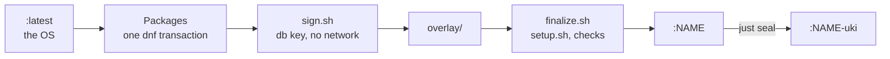

# Extras

An extra is an image for only some machines: the OS plus the features in
`extras/NAME/features/`, where `NAME` is the extra's name. The features use the
[Features](../features/README.md) format, without `build.sh`.

The image gets the tags `NAME` and `NAME-uki`, so `NAME` can have only
lowercase letters, digits, and hyphens, and can't be a tag that's taken:
`latest`, `live`, `base`, `*-uki`, `*-split`, or `build-*`. CI builds, scans,
and publishes every extra, and a release moves its tags.

[`image/extra.Containerfile`](../image/extra.Containerfile) builds every extra
on top of the OS:



An extra's overlay path that already exists on the OS fails the build. An
extra's feature can have one more file:

| File      | What it is                                                                                                                      |
| --------- | ------------------------------------------------------------------------------------------------------------------------------- |
| `sign.sh` | What needs the Secure Boot signature database (db) key, such as the NVIDIA kernel modules ([`image/sign.sh`](../image/sign.sh)) |

To build and seal an extra, run `just build NAME [FLAVOR]`. The optional
`FLAVOR` reaches the extra's `sign.sh` and `setup.sh` as `$FLAVOR`. For
example, `just build nvidia closed` selects the closed NVIDIA kernel modules.

To combine extras, create an extra whose features are links to theirs, so that
their packages resolve in one transaction. For example, with a hypothetical
`gaming` extra:

```sh
mkdir -p extras/nvidia-gaming/features
ln -s ../../nvidia/features/nvidia extras/nvidia-gaming/features/nvidia
ln -s ../../gaming/features/gaming extras/nvidia-gaming/features/gaming
```

The repository has these extras:

| Extra    | What it adds                                                                                                            |
| -------- | ----------------------------------------------------------------------------------------------------------------------- |
| `nvidia` | The NVIDIA driver, with kernel modules built and signed at build time; see [NVIDIA driver](../docs/os.md#nvidia-driver) |
