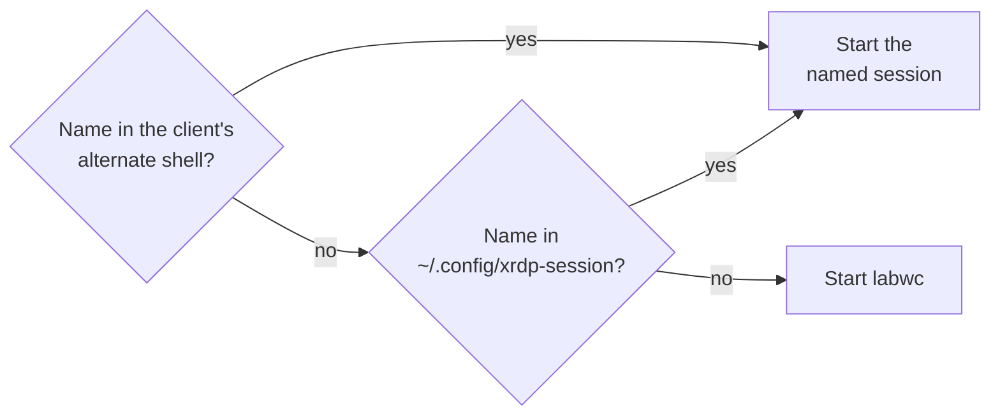

# XRDP

XRDP listens on port 3389 and accepts TLS connections only. Log in with your
normal account, not root, and enter the username and password in the client:
XRDP has no login screen and closes a connection without valid credentials.
The session is labwc unless you name `niri`, `sway`, `river`, or `wayfire`;
niri needs a GPU. The name can go in two places:



In Remmina, the alternate shell is **Advanced** > **Start-up program**; in
xfreerdp, it's `/shell`, such as `/shell:sway`. For the desktop to follow
Remmina's window size, turn on **Dynamic resolution update** and **Use initial
window size**. Sessions log to `~/.xrdp-session.log`.

To check the certificate a client asks about, compare its fingerprint with
this command's output, using `-sha1` for Windows clients:

```sh
sudo openssl x509 -noout -fingerprint -sha256 -in /etc/xrdp/cert.pem
```
