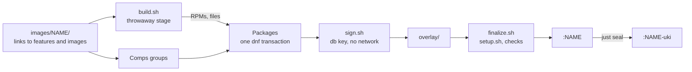

# Images

An image is a folder of `images/`, named `NAME`, that holds a link for each
[feature](../features/README.md) it has. A link can also lead to another
image, which brings in all of that image's features. Each link has the name of
what it leads to, relative, and a feature reached twice counts once.
[`image/os.Containerfile`](../image/os.Containerfile) builds every image the
same way, all of its features in one pass:



The image gets the tags `NAME` and `NAME-uki`, so `NAME` can have only
lowercase letters, digits, and hyphens, and can't be a name that a tag
already uses: `live`, `base`, `build`, `uki`, `*-uki`, `*-split`, or
`build-*`. CI builds, scans, and publishes every image, and a release moves
its tags.

To build and seal an image, run `just build NAME [FLAVOR]`. The optional
`FLAVOR` reaches every feature's `sign.sh` and `setup.sh` as `$FLAVOR`. For
example, `just build nvidia closed` selects the closed NVIDIA kernel modules.

To add an image, create its folder with links. For example, a hypothetical
`gaming` image with everything in `nvidia` plus a `gaming` feature:

```sh
mkdir images/gaming
ln -s ../nvidia images/gaming/nvidia
ln -s ../../features/gaming images/gaming/gaming
```

`just check` fails on a feature that's in no image. CI, the release, and the
daily security check pick up a new image by themselves. The live ISO installs
only `latest-uki` and `nvidia-uki`, and a machine moves to another image with
`sudo bootc switch ghcr.io/lucarickli/fedora-bootc:NAME-uki`. Add the new
tags to the tag table in the [README](../README.md) and to
[`SECURITY.md`](../SECURITY.md).

The repository has these images:

| Image    | Features                                                                                  |
| -------- | ----------------------------------------------------------------------------------------- |
| `latest` | Every feature except `nvidia`                                                             |
| `nvidia` | Those of `latest` and the NVIDIA driver; see [NVIDIA driver](../docs/os.md#nvidia-driver) |
