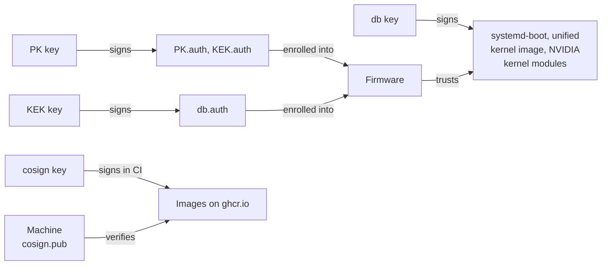

# Signing keys

`just keygen` creates fedora-bootc's Secure Boot keys with `sbctl`: the
Platform Key (PK), the Key Exchange Key (KEK), and the signature database (db)
key. `just cosign-keygen` creates its cosign key. These keys sign what machines
boot and install:



Every image carries two enrollment sets of `PK.auth`, `KEK.auth`, and
`db.auth` ([`image/enroll.sh`](../image/enroll.sh)). To enroll one, see
[Enroll the keys](../docs/secureboot-tpm2.md#enroll-the-keys). The
`fedora-bootc-and-microsoft` set also adds
[Microsoft Secure Boot certificates](microsoft/README.md) to KEK and db.

## Key locations

The private keys stay outside the checkout, in the key directory:
`$XDG_DATA_HOME/fedora-bootc/keys`, which is `~/.local/share/fedora-bootc/keys`
by default, or the path in `FEDORA_BOOTC_KEYS`. The following layout shows the
key directory as `KEY_DIR`:

```text
keys/GUID              EFI owner GUID                       committed, used by the build
keys/PK/PK.pem         PK certificate                       committed, used by the build
keys/KEK/KEK.pem       KEK certificate                      committed, used by the build
keys/db/db.pem         db certificate                       committed, used by the build
keys/microsoft/        Microsoft's KEK and db certificates  committed, used by the build
keys/cosign.pub        cosign public key                    committed, copied into the image
keys/sbctl.conf        sbctl settings for just keygen       committed

KEY_DIR/PK/PK.key      private keys                         never in the checkout;
KEY_DIR/KEK/KEK.key                                         the build needs PK, KEK, and db
KEY_DIR/db/db.key
KEY_DIR/cosign.key
KEY_DIR/GUID           copies of keys/GUID and keys/*/*.pem, for sbctl
KEY_DIR/*/*.pem
```

> [!WARNING]
> Back up the key directory. You can replace a lost key only one machine at a
> time.

To build with keys or certificates from other files, set these environment
variables to their paths:

| Variables                                   | Files                   |
| ------------------------------------------- | ----------------------- |
| `SECUREBOOT_KEY`, `SECUREBOOT_CERT`         | db key and certificate  |
| `SECUREBOOT_PK_KEY`, `SECUREBOOT_PK_CERT`   | PK key and certificate  |
| `SECUREBOOT_KEK_KEY`, `SECUREBOOT_KEK_CERT` | KEK key and certificate |

To build without the PK and KEK keys, sign the enrollment sets with
`just enroll DIR`, then set `ENROLL_DIR` to `DIR`. A build checks that the
sets enroll the certificates in `keys/`. Sign them again after a change to
`keys/GUID`, `keys/microsoft/`, or `image/enroll.sh`, which that check
doesn't cover.

For how a build uses the keys, see
[How the build works](../docs/architecture/build.md#signing-keys).

## CI secrets

CI reads the private keys from four secrets of its `release` environment,
listed in [Create your own fork](../docs/fork.md). The PK and KEK keys can
replace what enrolled machines trust, and the db key can add to what they boot,
so all three are only as safe as that environment.

## Rotate the keys

Replacing a Secure Boot key means enrolling every machine again, as
[Rotate the keys](../docs/secureboot-tpm2.md#rotate-the-keys) describes.

Machines accept only images signed with the cosign key they trust, so replacing
it takes two releases.

> [!IMPORTANT]
> CI's `sign` and `promote` jobs verify against the committed
> `keys/cosign.pub`, so step 1 fails until CI changes.

To replace the cosign key:

1. Move the current private key aside, and create the replacement pair:

   ```sh
   mv KEY_DIR/cosign.key KEY_DIR/cosign.key.old
   rm keys/cosign.pub
   just cosign-keygen
   ```

   `KEY_DIR` is the [key directory](#key-locations). Don't replace
   `SIGNING_SECRET` until step 2, although `just cosign-keygen` says to. Commit
   the replacement `keys/cosign.pub`, and publish a release, still signed with
   the current key. Machines that upgrade to it trust only the replacement key.

2. Replace `SIGNING_SECRET` with the replacement key. A machine that skipped
   the first release rejects images signed with it.

   The dev container's repository signs the dev container and the VS Code
   Flatpak with the same key, so also replace that repository's
   `keys/cosign.pub` and `SIGNING_SECRET`, and run its devcontainer workflow to
   re-sign the dev container.
